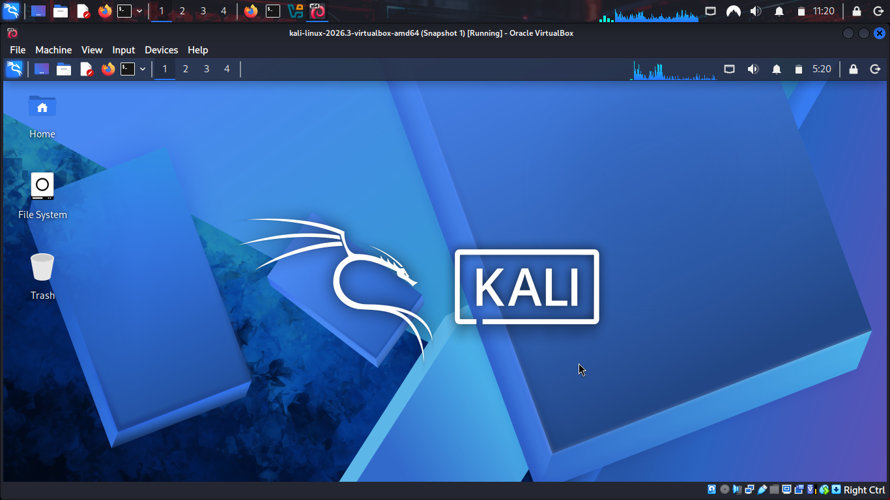
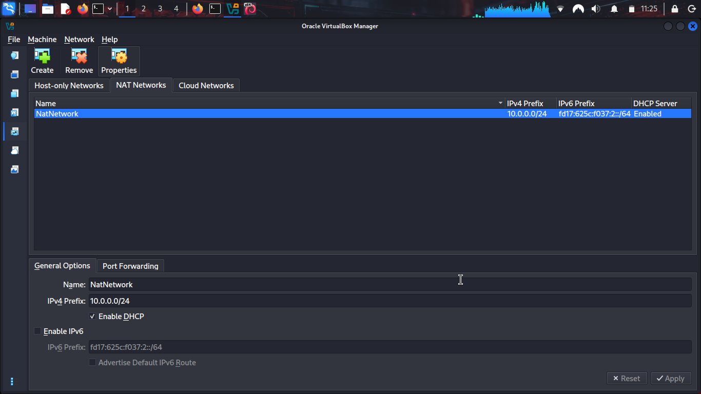
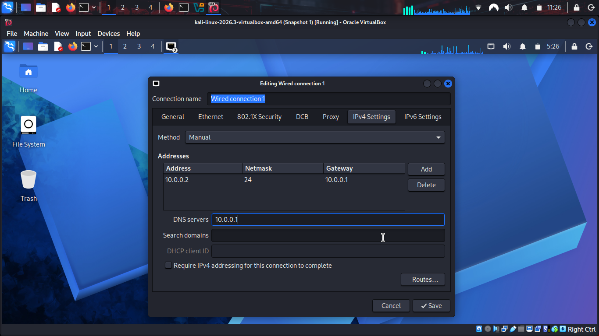

# 🔐 Cybersecurity Lab Environment Setup (Linux Host Edition)

Building an isolated virtual target environment inside a Kali Linux native host system.

## 📌 Project Overview
This project focuses on deploying a dedicated virtual cybersecurity testing lab. Unlike standard configurations deployed on commercial host systems, this laboratory was built using a native Kali Linux bare-metal operating system as the primary deployment host. 

Using VirtualBox, an isolated network switch fabric was created to allow a native attacking machine to interact seamlessly with virtualized target nodes while preserving network isolation.

## 🎯 Objectives
* Configure Oracle VirtualBox directly on a Linux bare-metal host.
* Establish a private, isolated NAT Network topology for target orchestration.
* Address and resolve immediate Linux network interface resolution blocks.
* Document real-world shell constraints and syntax errors encountered during setup.
* Establish baseline snapshots to ensure lab state repeatability.

## 🏗️ Lab Architecture
The bare-metal Kali Linux system acts as both the primary hypervisor manager and the foundational attacking platform, controlling access to a specialized internal network range.



## ⚙️ Lab Configuration
* **Host Operating System:** Kali Linux (Bare Metal)
* **Hypervisor Engine:** VirtualBox 7.x (Linux Core Package)
* **Virtual Network Mode:** NAT Network (`NatNetwork`)
* **Internal Network Subnet:** 10.0.0.0/24
* **Target Lab VM Range:** 10.0.0.3 – 10.0.0.99
* **Lab Network Default Gateway:** 10.0.0.1
* **Upstream Laboratory DNS:** 8.8.8.8

## 🪜 Deployment Log

### Step 1. Hypervisor Provisioning
VirtualBox was installed directly via the Linux package management framework to handle virtualized target instances.

### Step 2. Isolated Network Switching
A custom virtual NAT Network was defined within VirtualBox:
* **Network Name:** NatNetwork
* **Subnet Prefix:** 10.0.0.0/24
* **DHCP Server Status:** Enabled



This profile constructs an internal software switch allowing guest target nodes to interact with each other safely, while obtaining controlled outbound access through the host's physical wireless/ethernet drivers.

### Step 3. Interface Alignment
Network interfaces within the workspace were configured manually to bind cleanly to the `10.0.0.0/24` lab subnet variables. 



### Step 4. Recovery Engineering
Before integrating vulnerable machines, the baseline network framework was verified and snapshotted within the hypervisor interface to ensure a clean recovery point.

## 🔎 Interface & Pipeline Verification
* **Local Interface Probe (`ip a`):** Validated active adapter addresses.
* **Gateway Traversal Test (`ping 10.0.0.1`):** Verified stable local routing.
* **Raw Transit Test (`ping 8.8.8.8`):** Confirmed ICMP outbound path bypasses restrictions.
* **Domain Name Resolution (`nslookup google.com`):** Confirmed active string translation.

## 🐞 Terminal Obstacles & Technical Fixes

### Problem 1. Outbound Resolution Failures
During manual network modifications, domain configurations dropped, preventing standard tools from resolving web addresses because the manual DNS properties panel was locked onto `10.0.0.1` instead of an active public lookup address.
* **Error Sign:** `ping: ://google.com: Temporary failure in name resolution`
* **Resolution Pipeline:** Injected reliable up-stream nameservers into the core kernel resolution table using privileged stream operations:
  ```bash
  echo "nameserver 8.8.8.8" | sudo tee /etc/resolv.conf
  echo "nameserver 8.8.4.4" | sudo tee -a /etc/resolv.conf
  ```

### Problem 2. Shell Redirection Privilege Contraction (`zsh`)
Attempting to write network targets directly via standard root commands resulted in immediate security access rejections.
* **Command Syntax:** `sudo echo "nameserver 8.8.8.8" > /etc/resolv.conf`
* **Error Returned:** `zsh: permission denied: /etc/resolv.conf`
* **Root Cause Analysis:** The `>` operator is executed by the unprivileged parent shell environment. Elevating `echo` with `sudo` does not pass execution permissions down the line to the file modification system.
* **Solution:** Used the system utility `tee` behind an elevated pipe to allow the write process to inherit administrative privileges cleanly.

### Problem 3. Application Layer Protocol Contamination
Testing basic network endpoints failed when web application formatting was introduced to the command string.
* **Command Syntax:** `ping -c 3 ://google.com`
* **Error Returned:** `ping: ://google.com: Name or service not known`
* **Root Cause Analysis:** `ping` operates on the Layer 3 Network layer using raw ICMP. It cannot interpret web-browser schemes like `://`.
* **Solution:** Stripped out all browser-based string additions to keep the command native: `ping -c 3 google.com`.

### Problem 4. Virtualbox Inter-Adapter Network Conflicts
Newer Linux network managers occasionally drop communication when dealing with virtual bridges due to duplicate address detection flags.
* **Solution:** Used the network command manager to explicitly reset the driver interface constraints:
  ```bash
  sudo nmcli connection modify "Wired connection 1" ipv4.dad-timeout 0
  sudo nmcli connection down "Wired connection 1"
  sudo nmcli connection up "Wired connection 1"
  ```

## 💡 Core Takeaways
1. **Linux Redirection Boundaries:** Mastered the structural limits of terminal redirection (`>`), learning how to weaponize `tee` to manipulate root network files securely under standard user sessions.
2. **Layer Separation:** Solidified differences between network layer utilities (`ping`) and application layer targets (`http/https`), preventing command syntax errors down the road.
3. **Hypervisor Isolation:** Successfully designed a multi-tier hacking range where a physical Linux machine manages virtualized target subnets securely.

## 🔐 Security & Ethical Use Notice
This lab deployment is exclusively built for authorized research, educational development, and sandbox security validation.


👤 Author
* **Name:** Joshua Ngulube
* **Role:** Student
* **LinkedIn:**[linkedin.com/in/joshua-ngulube-2497a0439](https://linkedin.com)

📌 Project Information
* **Program Architecture:** Cybersecurity at NetworkWalks
* **Timeline Block:** Week 01
* **Lab Target Assignment:** Cybersecurity & Pentesting Lab Setup (Phase 1)
